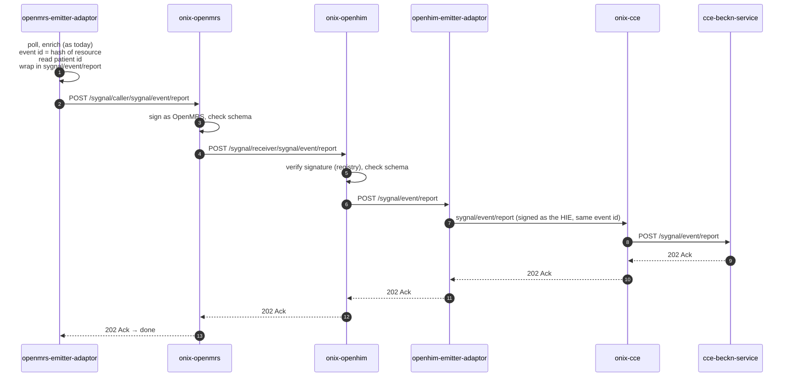
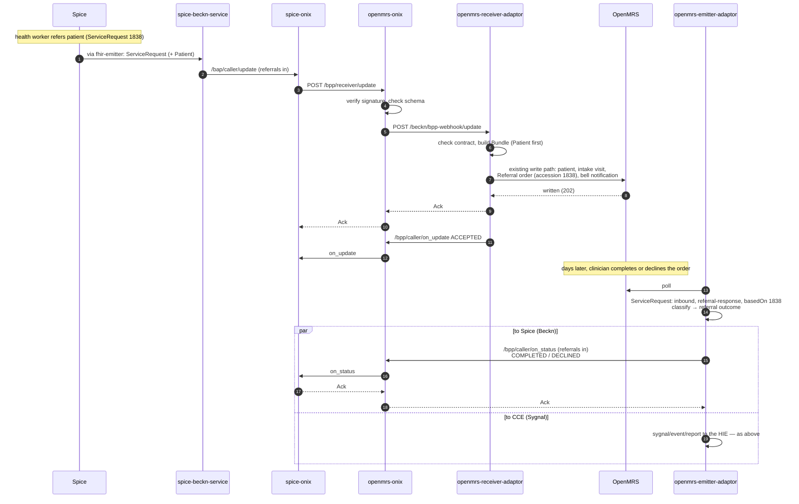
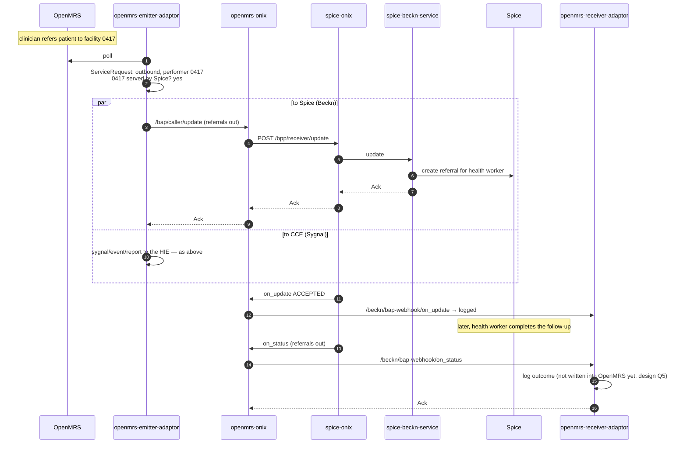
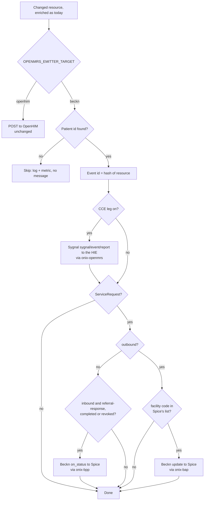

# Beckn Integration — OpenMRS CCE Emitter Adaptor

**Status:** Implemented on branch `sygnal-actions` (package `org.openphc.cce.emitter.beckn`), with unit tests and a stubbed-onix integration test. Not yet tested against real onix containers.

In Beckn mode the emitter sends on three legs, with **two protocols**:

| Leg | Protocol | Message | To | Through |
|---|---|---|---|---|
| CCE events (`cce-events`) | **Sygnal** | `sygnal/event/report` | The HIE (OpenHIM), which passes it on to CCE | `onix-openmrs` Sygnal caller |
| Referrals in (`referrals-in`) | **Beckn**, as on `demo-beckn` (new box since 2026-11-23, §8.3) | `on_status` | Spice | `onix-bpp` |
| Referrals out (`referrals-out`) | **Beckn**, as on `demo-beckn` (new box since 2026-11-23, §8.3) | `update` | Spice | `onix-bap` |

The CCE events leg follows the CCE profile of Sygnal, `schema/sygnal-profile/v3.0/` in the cce-beckn-service repository: `cce-sygnal-apis.yaml`, which refers to `cce-fhir-extension.yaml` for the FHIR fields. These two files are the binding contract between OpenMRS, the HIE and CCE. The Beckn `update` on the "HIE feed" contract, its commitment file and its `openhim.*` settings are gone. The Spice referral legs are standard Beckn and behave as on `demo-beckn`: same actions, contracts, settings and metrics. Only their `performanceAttributes` box changed, on 2026-11-23 (§8.3). The central design for them is **"Design: Beckn support for OpenMRS"** in the `openmrs-beckn-service` repository; section numbers in brackets, such as (§4.5), point to that document.

With `OPENMRS_EMITTER_TARGET=openhim` nothing in this document applies. The emitter posts FHIR to OpenHIM exactly as it does today.

> **Change 2026-11-23: extended Sygnal types (profile v3.0).** On 2026-11-23 the customer decided to open and extend CCE's copy of `sygnal:CoordinationEvent` (profile v3.0), instead of using the `cce:CceClinicalEvent` payload (profile v2.0, merged here earlier the same day). The event of `sygnal/event/report` is again a `sygnal:CoordinationEvent`, now with the clinical-event fields `patientId`, `fhirVersion`, `sourceEventId` and `resource` directly on it (§8.1). There is no `cce:` type, no `eventAttributes` bag and no `@context` in the Sygnal message. The reasons and the history (profiles v1.0, v2.0, v3.0) are in the contract, `schema/sygnal-profile/v3.0/cce-sygnal-apis.yaml`.
>
> Everything else is unchanged: the action name and path, the Sygnal `context`, the `Ack` / `Nack` answers and codes, the retry rules, the event id, every setting, and the Spice referral legs (standard Beckn, with the same `performanceAttributes` box as before, §8.3). The box changed later the same day; see the next note.
>
> **Change 2026-11-23: the box of the Spice referral legs is a `sygnal:CoordinationEvent`.** The `performanceAttributes` box of `on_status` and `update` is no longer a `cce:CceClinicalEvent` v1.0. It is the same `sygnal:CoordinationEvent` as the event of `sygnal/event/report` (§8.1), with an `@context` first: Beckn core requires `@context` on `performanceAttributes`, and onix checks a typed object only when it has one (§8.3). `eventType` in the box is now `DELIVERY_RECORDED`, not the FHIR resource type; the kind of clinical event is `resource.resourceType`. The schema is `schema/CoordinationEvent/v3.0/` in cce-beckn-service; `CceClinicalEvent/v1.0` and `CceCareAlert/v1.0` are deleted. The schema set of `onix-bap` and `onix-bpp` (onix 1.9.4) is now `CoordinationEvent/v3.0` plus the Health* pack.
>
> Spice must make the same change at the same time, in its boxes and in its referral adapters' schema set. An adapter without the old schema refuses the old `cce:CceClinicalEvent` box (`SCH_SCHEMA_ADAPTATION_FAILED`). The actions, contracts, settings, metrics and the referral classification are unchanged; `emitter.beckn.schema-base-url` is now the base of the box's `@context`. Checked with four onix 1.9.4 referral adapters (OpenMRS's pair and a stand-in Spice pair): the six referral messages pass and malformed boxes are refused (19 of 19 cases).
>
> **Change 2026-11-24: Sygnal's types word for word.** CCE's copy of the Sygnal schema now keeps `sygnal:CoordinationEvent` and `sygnal:Signal` exactly as Sygnal v0.9.0 publishes them, except `additionalProperties: true`. CCE's rules (the event `id` is required and a UUID, `revision` is 1) moved into `cce-fhir-extension.yaml`, next to the FHIR fields. The event this emitter sends, on the Sygnal leg and in the box of the referral legs, is unchanged, and so are its code and settings; `onix-openmrs` and the referral adapters only need the new copies of the schema files.

---

## 1. Summary

- A setting, `OPENMRS_EMITTER_TARGET`, chooses the path: `beckn` (the default on this branch) or `openhim` (today's path).
- In `beckn` mode every changed resource goes to the HIE as one Sygnal `sygnal/event/report`, through OpenMRS's Sygnal onix (`onix-openmrs`). The HIE passes it on to CCE. No callback follows; the synchronous answer (`202` + `Ack`, or a `Nack`) is the whole result.
- A referral `ServiceRequest` can also lead to one Beckn message to Spice: `on_status` for the outcome of a referral from Spice, or `update` for a referral out to Spice. Their actions and contracts are unchanged; their box is a `sygnal:CoordinationEvent` since 2026-11-23 (§8.3).
- The FHIR resource travels unchanged in `resource`: on the Sygnal leg in the event itself, the extended `sygnal:CoordinationEvent` (§8.1); on the Beckn legs in the `performanceAttributes` box, the same `sygnal:CoordinationEvent` with an `@context` (§8.3). The emitter builds no CloudEvent.
- Polling, enrichment, the national-ID rewrite and the checkpoint stay as they are.
- No new endpoint. Spice's callbacks (`on_update`, `on_status`) go to the receiver adaptor, not the emitter.

---

## 2. The flows

```
---- OpenMRS to CCE (Sygnal) ----
openmrs-emitter-adaptor --sygnal/event/report--> onix-openmrs ══► onix-openhim → openhim-emitter-adaptor
                                                                                       │
                     cce-beckn-service ◄── onix-cce ◄══ onix-openhim ◄─sygnal/event/report┘

---- Spice to OpenMRS (Beckn, unchanged) ----
Spice → fhir-emitter → spice-beckn-service → spice-onix(bap) ══► openmrs-onix(bpp) → openmrs-receiver-adaptor → OpenMRS

---- OpenMRS to Spice (Beckn, unchanged) ----
OpenMRS → openmrs-emitter-adaptor → openmrs-onix(bap) ══► spice-onix(bpp) → spice-beckn-service → Spice
```

══ marks a signed hop: signed by the sender's adapter and checked by the receiver's adapter. ─ marks plain HTTP.

### 2.1 The emitter's part in each flow

| Flow | Emitter's part |
|---|---|
| OpenMRS to CCE | Sends every changed resource as Sygnal `sygnal/event/report` to the HIE, through `onix-openmrs`. The HIE forwards the event to CCE with the same event id |
| Spice to CCE | None |
| Spice to OpenMRS | The receiver adaptor writes the referral. When the clinician completes or declines it, the emitter sends Beckn `on_status` to Spice on the "referrals in" contract, through `onix-bpp` (§5.4, steps 5–6) |
| OpenMRS to Spice | Sends Beckn `update` to Spice on the "referrals out" contract, through `onix-bap`, when the destination facility is one Spice serves (§5.5) |

In the last two flows the emitter also sends the same `ServiceRequest` to the HIE for CCE, as in the first flow (§5.6).

### 2.2 Sygnal participants

| Participant | Subscriber id (`senderId` / `receiverId`) | onix container |
|---|---|---|
| OpenMRS (this emitter) | `bap.openmrs.nextsteps.mdtlabs.org` | `onix-openmrs` |
| HIE | `bap.openhim.nextsteps.mdtlabs.org` | `onix-openhim` |
| CCE | `bpp.cce.nextsteps.mdtlabs.org` | `onix-cce` |

Each Sygnal onix listens on `8082` inside its container. An app **sends** by posting the full message to `http://<onix-container>:8082/sygnal/caller/<action>`; onix signs it and delivers it to `context.receiverUri + "/" + action`. onix **receives** at `https://<public-host>/sygnal/receiver/<action>`, checks the signature and the schema, and forwards to the app at `/<action>`.

### 2.3 Flow diagrams

**OpenMRS → CCE: an event (Sygnal).**



**Spice → OpenMRS: a referral, and its outcome (Beckn, unchanged).** The receiver takes the referral. Later the emitter sends the outcome as `on_status`, and the same order to the HIE.



**OpenMRS → Spice: a referral, and its outcome (Beckn, unchanged).** The emitter sends `update` on the "referrals out" contract. Spice's callbacks go to the receiver.



**The emitter in Beckn mode.** Each message is sent and retried on its own.



---

## 3. The target switch

| `OPENMRS_EMITTER_TARGET` | Behaviour |
|---|---|
| `openhim` | Today's behaviour. `ForwardingEngine` posts FHIR JSON to `{OPENHIM_BASE_URL}/{ResourceType}` |
| `beckn` (default on this branch) | `BecknTargetForwarder` posts `sygnal/event/report` to the onix Sygnal caller and, for referrals, Beckn messages to the `onix-bap` / `onix-bpp` callers |

The switch is read once at start. Changing it needs a restart. One emitter sends on one path only; it never sends the same resource to both.

What stays the same in both modes:

- `FhirPollerService` polling, paging and de-duplication.
- `OrderRevisionResolver`, `PatientReferenceRewriter`, `OrderIdentifierEnricher`, `ReferralResponseOrderEnricher` and the other enrichers and normalizers.
- `CheckpointStore` and the bookmark behaviour.
- The retry settings `emitter.openhim.retry.*`.

---

## 4. Processing steps in Beckn mode

`FhirPollerService.forwardOne` runs all enrichers as today and encodes the resource to JSON. It then hands the JSON to `BecknTargetForwarder` instead of `ForwardingEngine`. For each resource:

| Step | Class | What it does |
|---|---|---|
| 1 | `EventIdFactory` | Builds the event id from the resource JSON (§5) |
| 2 | `PatientIdReader` | Reads the patient id (§6) |
| 3 | `BecknMessageBuilder` | Builds Sygnal `sygnal/event/report` (§8.1) |
| 4 | `OnixClient` | Posts it to the Sygnal caller of `onix-openmrs`. Reads `Ack` / `Nack`. Retries when allowed (§10) |
| 5 | `ReferralClassifier` | For a `ServiceRequest`, decides whether Spice gets a message too (§7) |
| 6 | `BecknMessageBuilder` + `OnixClient` | If so, builds and posts Beckn `on_status` (through `onix-bpp`) or `update` (through `onix-bap`) (§8.2) |
| 7 | `BecknMessageLog` | Writes one log line per message (§13) |
| 8 | `BecknTargetForwarder` | Returns a `ForwardResult` to the poller. It is a success only if every message for the resource got `Ack` |

Step 6 runs whether step 4 worked or not. The two messages are sent and retried on their own (§5.6).

After the page is done, the poller saves the checkpoint as it does today, whatever the results.

---

## 5. Event id

The event id is a name-based UUID of a SHA-256 hash of the resource JSON, with keys in a fixed order (§5.2).

1. Take the resource JSON exactly as it goes into `resource`, after all enrichers.
2. Write it again with object keys sorted, at every level. Arrays keep their order. No whitespace.
3. Hash the UTF-8 bytes with SHA-256.
4. Build a version-5 (name-based) UUID from the hex hash (lower-case hex, as UTF-8 text), with a fixed namespace UUID set once in the code: `6f1c9a52-3d8e-4b27-9e14-0a7c5d2b8f31` (`EventIdFactory.NAMESPACE`).

Decimals are read exactly (`1.50` stays `1.50`), both for the hash and for the `resource` that is sent.

The same event id is used on every leg: it is `message.events[0].id` (the `sygnal:CoordinationEvent` id) on the Sygnal leg, and `performance[0].id` on the Beckn referral legs.

How CCE uses it: the HIE forwards the event to CCE with the **same id** on every hop, so CCE's collector recognises a repeat and answers `Ack` without storing it twice. CCE allows at most 50 characters; a UUID is 36.

Why a hash and not `meta.lastUpdated`:

- The same change always gets the same id. A resend gives the same id, and CCE drops the duplicate.
- Any change to the resource gives a new id. After CCE refuses an event (`BIZ_GENERIC_ERROR`), the corrected resource has a new hash, so it gets a new id. With the old id CCE would drop it as a duplicate.
- The resource type and id are inside the JSON, so two resources never share an id.
- OpenMRS can change an older order's status without moving its `lastUpdated`. The timestamp also has whole seconds only, and can be missing.

The namespace UUID must never change. If it does, every event gets a new id.

`sourceEventId` (in the event on the Sygnal leg, in the box on the Beckn legs) is `{ResourceType}/{id}`. It is not the event id.

---

## 6. Patient id

`patientId` is required on every leg, by the `sygnal:CoordinationEvent`: the event of the Sygnal leg and the box of the Beckn legs. `PatientIdReader` reads it in a simple way:

| Resource | `patientId` |
|---|---|
| `Patient` | Its national-id identifier (system `emitter.patient.national-id.system`); if it has none, its id. `PatientReferenceRewriter` has already set the id to the national ID, so both are normally the same |
| Any resource with `subject` or `patient` | The reference without `Patient/`. `PatientReferenceRewriter` has already put the national ID there |

No facility id is read. The HIE reads the facility from the resource, as today.

The emitter makes no extra call to OpenMRS for this. It relies on the national-ID rewrite (`emitter.patient.national-id.*`). With `on-missing=forward-as-is`, the reference can still hold the OpenMRS UUID; that value is then sent as is.

**Resources without a patient** (for example `Location`, `Practitioner`, or a reference that is not `Patient/…`): `patientId` is required, so in Beckn mode the emitter **skips** them. It sends no message, writes one INFO line `beckn skip resourceType=… reason=no-patient`, and counts `openmrs_beckn_resources_skipped_total{reason="no-patient"}`. The bookmark moves on as for any other resource. To stop polling them at all, remove them from `POLLING_FHIR_RESOURCE_TYPES`.

---

## 7. Referral classification (Beckn legs, unchanged)

`ReferralClassifier` reads only markers that the emitter itself added (§2.1 of the central design). It runs for `ServiceRequest` only. The first matching rule wins.

| # | Condition | Message to Spice | Contract | Through |
|---|---|---|---|---|
| 1 | `category` has system `http://cce.openphc.org/CodeSystem/referral-direction`, code `inbound`, **and** system `http://cce.openphc.org/CodeSystem/event-type`, code `referral-response`, and `status` is `completed` or `revoked` | `on_status`. Performance status `COMPLETED` for `completed`, `DECLINED` for `revoked` | Referrals in | `onix-bpp` `/bpp/caller/on_status` |
| 2 | `category` has system `http://cce.openphc.org/CodeSystem/referral-direction`, code `outbound` (whatever the status), and a `performer[].identifier` with system `http://cce.openphc.org/fhir/NamingSystem/facility-code` whose value is in `emitter.beckn.spice.facility-codes` | `update` | Referrals out | `onix-bap` `/bap/caller/update` |
| 3 | An open `inbound` referral (the echo of a referral the receiver wrote), an `outbound` referral to a facility Spice does not serve, or anything else | None | — | — |

Every resource, including those in rules 1 and 2, also goes to the HIE as Sygnal `sygnal/event/report`.

`OrderIdentifierEnricher` adds `referral-response` to every completed or revoked referral order, whatever its direction. That is why rule 1 also needs `inbound`: a completed referral *out* must not go back as `on_status` on the "referrals in" contract. It goes to Spice under rule 2 as a changed referral.

Where the markers come from:

| Marker | Set by | Setting that holds the system |
|---|---|---|
| `referral-response` category, `basedOn` | `OrderIdentifierEnricher` | `emitter.referral.response.category-system`, `emitter.referral.response.based-on-identifier-system` |
| `inbound` / `outbound` category | `OrderIdentifierEnricher` | `emitter.referral.direction.category-system` |
| Destination facility code on `performer` | `OrderIdentifierEnricher` | `emitter.referral.direction.destination-identifier-system` |

The classifier reads the systems and codes from these existing settings; it does not repeat them.

Each change to a referral out goes to Spice again as a new `update`, with the same `ServiceRequest` id. Spice must treat it as a change.

---

## 8. Messages

### 8.1 CCE events leg: Sygnal `sygnal/event/report`

`BecknMessageBuilder.eventReport` fills the message from `emitter.beckn.sygnal.*`. There is no contract, no commitment, no `bapId` / `bppId` / `bapUri` / `bppUri`: the Sygnal `context` is a closed object and onix refuses any other field.

**`context`**

| Field | Value |
|---|---|
| `version` | `2.0.0` |
| `action` | `sygnal/event/report` |
| `networkId` | `sygnal.network-id` (required; default `sygnal.nextsteps.mdtlabs.org/sygnal_demo_network_registry`) |
| `senderId` | `sygnal.id` (`bap.openmrs.nextsteps.mdtlabs.org`) |
| `receiverId` | `sygnal.hie.id` (`bap.openhim.nextsteps.mdtlabs.org`) |
| `receiverUri` | `sygnal.hie.uri`: the HIE's public onix receiver base, e.g. `https://hie.example.org/sygnal/receiver` (onix appends the action) |
| `transactionId` | `sygnal.hie.transaction-id` when set (must be a UUID); otherwise a new random UUID per event, kept across the retries of that event. Never derived from patient data |
| `messageId` | A new random UUID for every attempt, including each retry (§10) |
| `timestamp` | The send time of the attempt |

**`message.events[0]`** — exactly one `sygnal:CoordinationEvent`, as extended in CCE's copy of the Sygnal schema (`CoordinationEvent` in `schema/sygnal-profile/v3.0/cce-sygnal-apis.yaml` in the cce-beckn-service repository, with the FHIR fields in `CoordinationEventFhirExtension` of `cce-fhir-extension.yaml` in the same folder). The clinical-event fields are on the event itself: there is no `cce:CceClinicalEvent` type, no `eventAttributes` bag and no `@context`. The emitter writes the fields in this order:

| Field | Required | Value |
|---|---|---|
| `@type` | Yes | `sygnal:CoordinationEvent` |
| `id` | Yes | The event id (§5), a UUID. The same on every hop and every retry |
| `revision` | No | `1`, always. A correction is a new event with a new id (§5) |
| `eventType` | Yes | `DELIVERY_RECORDED`, always. This is Sygnal's field; the kind of clinical event for CCE is `resource.resourceType` |
| `granularity` | No | `INDIVIDUAL` |
| `from` | No | `{ "id": sygnal.id, "role": "PROVIDER" }`. `from.id` equals `context.senderId` |
| `occurredAt` | Yes | `meta.lastUpdated` of the resource as a UTC instant; the build time if it is missing or not a full timestamp (see below) |
| `patientId` | Yes | §6 |
| `fhirVersion` | Yes | `4.0.1` |
| `sourceEventId` | No | `{ResourceType}/{id}`. Left out when the resource has no id |
| `resource` | Yes | The FHIR resource, as the emitter built it. Its `resourceType` is the kind of clinical event |

"Required" is what the profile requires; the emitter always sends every field of the table except `sourceEventId`, which it leaves out when there is none. It sends these fields and nothing else, and never a `null`. The profile also allows `facilityId` and `facilityName`; the emitter does not send them (the facility is in the resource). In CCE's copy the type is open (`additionalProperties: true`), so a receiver ignores a field it does not know; a validator that uses Sygnal's published schema, where the type is closed, would refuse this event. Every participant of this network loads CCE's copy.

`occurredAt` is when OpenMRS recorded **this version** of the resource, which is the version the event id is the hash of. It is present on every resource type and is always a full instant. The time of the clinical act itself (`Encounter.period.start`, `Observation.effectiveDateTime`, `ServiceRequest.authoredOn`, …) stays in the resource; CCE's `ClinicalEventTimeExtractor` reads it from there and prefers it over the envelope time for its schedules, so the emitter does not keep a second copy of that table. A prior order refetched by `OrderRevisionResolver` keeps its old `lastUpdated` (OpenMRS does not move it when the status flips), so its `occurredAt` is the time of the original order.

### 8.2 Spice referral legs: Beckn `on_status` / `update` (unchanged)

There are two fixed referral contracts. No message opens one. The ids are settings (§4.3).

| Contract | Consumer | Provider (issues the ids) | Action the emitter sends |
|---|---|---|---|
| Referrals in | Spice | OpenMRS | `on_status` (as provider, through `onix-bpp`) |
| Referrals out | OpenMRS | Spice | `update` (as consumer, through `onix-bap`) |

`BecknMessageBuilder` fills `context` and `message.contract` from the settings:

| Field | Spice `on_status` | Spice `update` |
|---|---|---|
| `networkId` | `self.network-id`, if set | `self.network-id`, if set |
| `bapId` / `bapUri` | `spice.bap-*` | `self.bap-*` |
| `bppId` / `bppUri` | `self.bpp-*` | `spice.bpp-*` |
| `transactionId` | `spice.referrals-in.transaction-id` | `spice.referrals-out.transaction-id` |
| `contract.id` | `spice.referrals-in.contract-id` | `spice.referrals-out.contract-id` |
| `commitments` | `spice.referrals-in.commitment-file` | `spice.referrals-out.commitment-file` |

`messageId` is a new random UUID for every attempt, including each retry (§10). `timestamp` is the send time. `version` is `2.0.0`. `networkId` is optional and left out when `self.network-id` is not set (it is separate from the Sygnal `sygnal.network-id`). `performance` always holds exactly one entry, whose `performanceAttributes` is the `sygnal:CoordinationEvent` box (§8.3).

The demo sends no `confirm`. The Beckn specification asks for one before `update` (§3, §11).

### 8.3 The box of the Beckn legs: `sygnal:CoordinationEvent`

On the Beckn referral legs the box, `performanceAttributes`, is the same `sygnal:CoordinationEvent` as the event of the Sygnal leg (§8.1), with an `@context` first. Beckn core requires `@context` on `performanceAttributes`, and onix checks a typed object only when it has one. onix finds the schema by `@type`: `sygnal:CoordinationEvent` → `CoordinationEvent/attributes.yaml` in its local schema folder. The schema is `schema/CoordinationEvent/v3.0/` (`attributes.yaml`, `context.jsonld`) in the cce-beckn-service repository.

Until 2026-11-23 the box was a `cce:CceClinicalEvent` v1.0, with `eventType` = the FHIR resource type. That schema is deleted, and an adapter without it refuses the old box (`SCH_SCHEMA_ADAPTATION_FAILED`).

| Field | Required | Value |
|---|---|---|
| `@context` | Yes | `{OPENMRS_EMITTER_BECKN_SCHEMA_BASE_URL}/CoordinationEvent/v3.0/context.jsonld` |
| `@type` | Yes | `sygnal:CoordinationEvent` |
| `id` | Yes | The event id (§5), the same as the performance entry `id` |
| `revision` | No | `1`, always |
| `eventType` | Yes | `DELIVERY_RECORDED`, always. The kind of clinical event is `resource.resourceType` |
| `granularity` | No | `INDIVIDUAL` |
| `from` | No | `{ "id": <sender>, "role": "PROVIDER" }`. The sender is the subscriber id that sends the message: `self.bpp-id` (`context.bppId`) on `on_status`, `self.bap-id` (`context.bapId`) on `update` |
| `occurredAt` | Yes | `meta.lastUpdated` of the resource, as in §8.1 |
| `patientId` | Yes | §6 |
| `fhirVersion` | Yes | `4.0.1` |
| `sourceEventId` | No | `{ResourceType}/{id}`. Left out when the resource has no id |
| `resource` | Yes | The FHIR resource, as the emitter built it |

As on the Sygnal leg, the emitter sends these fields and nothing else, and never a `null`; it does not send the optional `facilityId` and `facilityName`.

There is no CloudEvent in the emitter. CloudEvents exist only in the HIE and in CCE.

---

## 9. Message samples

### 9.1 An event to the HIE (Sygnal `sygnal/event/report`)

Posted to `{OPENMRS_EMITTER_BECKN_SYGNAL_CALLER_URL}/sygnal/event/report`, by default `http://onix-openmrs:8082/sygnal/caller/sygnal/event/report`. The action is appended with its slashes as they are, never URL-encoded (`%2F`).

```json
{
  "context": {
    "version": "2.0.0",
    "action": "sygnal/event/report",
    "networkId": "sygnal.nextsteps.mdtlabs.org/sygnal_demo_network_registry",
    "senderId": "bap.openmrs.nextsteps.mdtlabs.org",
    "receiverId": "bap.openhim.nextsteps.mdtlabs.org",
    "receiverUri": "https://hie.example.org/sygnal/receiver",
    "transactionId": "0d5f8c1a-7b2e-4f6d-9a3c-1e2b3c4d5e6f",
    "messageId": "9c4e2a10-5d6f-4b7a-8c9d-0e1f2a3b4c5d",
    "timestamp": "2026-11-13T08:00:35Z"
  },
  "message": {
    "events": [
      {
        "@type": "sygnal:CoordinationEvent",
        "id": "3f6c1c1e-8a53-5b0e-9d7a-2b6f4e1a9c10",
        "revision": 1,
        "eventType": "DELIVERY_RECORDED",
        "granularity": "INDIVIDUAL",
        "from": { "id": "bap.openmrs.nextsteps.mdtlabs.org", "role": "PROVIDER" },
        "occurredAt": "2026-11-13T08:00:12Z",
        "patientId": "1198503150001234",
        "fhirVersion": "4.0.1",
        "sourceEventId": "Encounter/7d2c9b1e-4f3a-4e8b-9c6d-5a1b2c3d4e5f",
        "resource": {
          "resourceType": "Encounter",
          "id": "7d2c9b1e-4f3a-4e8b-9c6d-5a1b2c3d4e5f",
          "meta": { "lastUpdated": "2026-11-13T08:00:12.000+00:00" },
          "status": "finished",
          "subject": { "reference": "Patient/1198503150001234" },
          "period": { "start": "2026-11-13T07:30:00Z", "end": "2026-11-13T08:00:00Z" },
          "location": [ { "location": { "reference": "Location/0002" } } ]
        }
      }
    ]
  }
}
```

The tests check against this sample (`src/test/resources/beckn/sample-event-report.json`).

### 9.2 A referral outcome to Spice (Beckn `on_status`)

Posted to `{OPENMRS_EMITTER_BECKN_ONIX_BPP_CALLER_URL}/on_status`. The same `ServiceRequest` also goes to the HIE as `sygnal/event/report` (9.1), with the same event id and `sourceEventId`.

```json
{
  "context": {
    "version": "2.0.0",
    "action": "on_status",
    "bapId": "bap.spice.example.org",
    "bapUri": "https://spice.example.org/bap/receiver",
    "bppId": "bpp.openmrs.example.org",
    "bppUri": "https://openmrs.example.org/bpp/receiver",
    "transactionId": "a41f6b2c-9d3e-4a7b-8c1d-2e3f4a5b6c7d",
    "messageId": "f1e2d3c4-b5a6-4978-8a9b-0c1d2e3f4a5b",
    "timestamp": "2026-11-16T09:30:40Z"
  },
  "message": {
    "contract": {
      "id": "e2c9a7b4-6f1d-4b3a-9c8e-7d6f5a4b3c2d",
      "status": { "code": "ACTIVE" },
      "commitments": [ { "id": "referral", "...": "see the draft commitment in the central design, Appendix B.1" } ],
      "performance": [
        {
          "id": "6b7c8d9e-0f1a-5b2c-9d3e-4f5a6b7c8d9e",
          "status": { "code": "COMPLETED" },
          "performanceAttributes": {
            "@context": "https://raw.githubusercontent.com/openphc/cce-beckn-service/main/schema/CoordinationEvent/v3.0/context.jsonld",
            "@type": "sygnal:CoordinationEvent",
            "id": "6b7c8d9e-0f1a-5b2c-9d3e-4f5a6b7c8d9e",
            "revision": 1,
            "eventType": "DELIVERY_RECORDED",
            "granularity": "INDIVIDUAL",
            "from": { "id": "bpp.openmrs.example.org", "role": "PROVIDER" },
            "occurredAt": "2026-11-16T09:30:10Z",
            "patientId": "1198503150001234",
            "fhirVersion": "4.0.1",
            "sourceEventId": "ServiceRequest/0fe4c80e-3a2b-4c1d-8e9f-a0b1c2d3e4f5",
            "resource": {
              "resourceType": "ServiceRequest",
              "id": "0fe4c80e-3a2b-4c1d-8e9f-a0b1c2d3e4f5",
              "meta": { "lastUpdated": "2026-11-16T09:30:10Z" },
              "status": "completed",
              "intent": "order",
              "category": [
                { "coding": [ { "system": "http://cce.openphc.org/CodeSystem/event-type", "code": "referral-response" } ] }
              ],
              "basedOn": [
                { "identifier": { "system": "http://mdtlabs.com/service-request-id", "value": "1838" } }
              ],
              "subject": { "reference": "Patient/1198503150001234" },
              "note": [ { "text": "Patient seen. Medication adjusted. Review in four weeks." } ]
            }
          }
        }
      ]
    }
  }
}
```

The tests check against this sample (`src/test/resources/beckn/sample-on-status.json`, where the commitment is written out in full).

What to notice:

- The box has the same `id` as the performance entry: the event id. `from.id` is OpenMRS's BPP id, `context.bppId`, because OpenMRS sends this message. In an `update` it is `context.bapId`.
- `eventType` is `DELIVERY_RECORDED`. The kind of clinical event is `resource.resourceType`.
- `basedOn` holds `1838`, Spice's own referral id. Spice finds its referral by it.
- The contract stays `ACTIVE`. All referrals from Spice share it.
- A declined referral has performance status `DECLINED` and `ServiceRequest` status `revoked`.
- Nothing is removed from the resource on the Spice leg. The HIE removes clinical findings before CCE sees the event.

---

## 10. Answers and retries

onix passes the far side's answer back in the same HTTP call. On the CCE events leg the answer comes back hop by hop from CCE, so an `Ack` means CCE accepted the event (or already had it). On the Spice legs, it is Spice's answer. Every leg uses the same `Ack` / `Nack` shape and the same rules.

### 10.1 The answer body

`Ack` (HTTP 202 on the Sygnal leg, 200 on the Beckn legs):

```json
{ "message": { "status": "ACK", "messageId": "9c4e2a10-5d6f-4b7a-8c9d-0e1f2a3b4c5d" } }
```

`Nack`, HTTP 400 (the sender's error) or 5xx (temporary):

```json
{
  "message": {
    "status": "NACK",
    "messageId": "9c4e2a10-5d6f-4b7a-8c9d-0e1f2a3b4c5d",
    "error": { "code": "SCH_REQUIRED_FIELD_MISSING", "message": "events[0].id is missing" }
  }
}
```

Codes the emitter may see on the CCE events leg (canonical Beckn codes):

| Code | HTTP | Meaning |
|---|---|---|
| `CTX_MISSING_FIELD`, `CTX_INVALID_FIELD`, `CTX_ACTION_MISMATCH` | 400 | Something wrong in `context` (for example `receiverId` is not the receiver's id) |
| `SCH_INVALID_JSON`, `SCH_REQUIRED_FIELD_MISSING`, `SCH_SCHEMA_VALIDATION_FAILED`, `SCH_TYPE_NOT_SUPPORTED` | 400 | The message does not match the schema |
| `BIZ_GENERIC_ERROR` | 400 | CCE's collector refused the event |
| `NET_DOWNSTREAM_UNAVAILABLE`, `NET_INTERNAL_ERROR` | 500 | Something on the route is down. Send again later |

Spice's own codes are to be agreed. The emitter decides by HTTP status and `status`, not by code, so an unknown code is handled the same way.

As built (`OnixAnswer`): any 2xx answer (202 included) counts as `Ack` unless its body says `NACK`; a 2xx with a `NACK` body is a `Nack`. The emitter also reads the Beckn 1.x adapter shape `{"message":{"ack":{"status":"ACK"}}}`. A body that is empty or not JSON is judged by its HTTP status alone.

### 10.2 What the emitter does

| Answer | Meaning | The emitter |
|---|---|---|
| 2xx and not `NACK` | Accepted, or already known | Done |
| HTTP 400 (`NACK`), or any other 4xx except 408 and 429 | The message is wrong: schema, signature, context, contract, or refused | Fails the message. **No retry.** Logs `error.code` and `error.message` |
| HTTP 500 or other 5xx, 408, 429, timeout, or no answer | Something on the route is down or slow | Sends again |

- A resend keeps the same event id (and, on the Sygnal leg, the same `transactionId`) and uses a **new** `messageId`. CCE knows the event by its id, not by `messageId`.
- Retries use the existing settings `emitter.openhim.retry.max-attempts` (default 3) and `emitter.openhim.retry.backoff-ms` (default 2000, linear: backoff × attempt), as in `ForwardingEngine`.
- After the last try the emitter drops the message. It moves its bookmark on, as it does today.
- Each message is sent and retried on its own. A failure towards the HIE does not resend to Spice, and the other way round.
- Sending again is safe. CCE drops a repeat by event id. Spice must ignore a repeat with the same performance id.

### 10.3 Callbacks

The Sygnal leg has none: no `on_report` follows `sygnal/event/report`. On the Beckn legs the emitter does not wait for callbacks: `on_update` and Spice's `on_status` for a referral out go to the receiver adaptor, which logs them. `on_update` may arrive before the `Ack`, or not at all. The `Ack` is the proof.

### 10.4 Timeout budget

The answer comes back through every hop. Each hop must wait longer than the hop behind it, and the onix default wait (`responseHeaderTimeout`, 5 s) must be raised on every onix container in the chain. The emitter's wait (`emitter.beckn.onix.timeout`, 50 s, for every leg) is the outermost. The numbers are a starting point to agree with the HIE and CCE teams. Resources are sent one after another, so when the far side is slow, the poll is slowed too.

---

## 11. Settings

```yaml
emitter:
  target: ${OPENMRS_EMITTER_TARGET:beckn}           # beckn (default on this branch) | openhim
  beckn:
    onix:
      bap-caller-url: ${OPENMRS_EMITTER_BECKN_ONIX_BAP_CALLER_URL:http://onix-bap:8081/bap/caller}   # referrals out
      bpp-caller-url: ${OPENMRS_EMITTER_BECKN_ONIX_BPP_CALLER_URL:http://onix-bpp:8082/bpp/caller}   # referrals in
      timeout: 50s                             # every leg; outermost hop (§10.4)
    schema-base-url: ${OPENMRS_EMITTER_BECKN_SCHEMA_BASE_URL:https://raw.githubusercontent.com/openphc/cce-beckn-service/main/schema}
    sygnal:                                    # CCE events leg (Sygnal)
      caller-url: ${OPENMRS_EMITTER_BECKN_SYGNAL_CALLER_URL:http://onix-openmrs:8082/sygnal/caller}
      id: ${OPENMRS_EMITTER_BECKN_SYGNAL_ID:bap.openmrs.nextsteps.mdtlabs.org}
      network-id: ${OPENMRS_EMITTER_BECKN_SYGNAL_NETWORK_ID:sygnal.nextsteps.mdtlabs.org/sygnal_demo_network_registry}
      hie:
        id: ${OPENMRS_EMITTER_BECKN_SYGNAL_HIE_ID:bap.openhim.nextsteps.mdtlabs.org}
        uri: ${OPENMRS_EMITTER_BECKN_SYGNAL_HIE_URI:}                  # required
        transaction-id: ${OPENMRS_EMITTER_BECKN_SYGNAL_HIE_TRANSACTION_ID:}   # optional UUID
    self:                                      # Spice referral legs (Beckn)
      network-id:                              # optional; sent as context.networkId when set
      bap-id: bap.openmrs.example.org
      bap-uri: https://openmrs.example.org/bap/receiver
      bpp-id: bpp.openmrs.example.org
      bpp-uri: https://openmrs.example.org/bpp/receiver
    spice:
      name: Spice
      bap-id: bap.spice.example.org
      bap-uri: https://spice.example.org/bap/receiver
      bpp-id: bpp.spice.example.org
      bpp-uri: https://spice.example.org/bpp/receiver
      facility-codes: ["0417"]
      referrals-in:                            # OpenMRS sends on_status here
        contract-id: e2c9a7b4-6f1d-4b3a-9c8e-7d6f5a4b3c2d
        transaction-id: a41f6b2c-9d3e-4a7b-8c1d-2e3f4a5b6c7d
        commitment-file: classpath:beckn/commitment-referral.json
      referrals-out:                           # OpenMRS sends update here
        contract-id: 7c3d9e1f-5a2b-4d6c-8e7f-0a1b2c3d4e5f
        transaction-id: b52a7c3d-0e4f-4b8c-9d2e-3f4a5b6c7d8e
        commitment-file: classpath:beckn/commitment-referral.json
    legs:
      cce-events: true                         # Sygnal, to the HIE
      referrals-in: true                       # Beckn on_status, to Spice
      referrals-out: true                      # Beckn update, to Spice
```

| Setting | Meaning |
|---|---|
| `onix.timeout` | Time to wait for one answer, on every leg. Default 50 s. Must be longer than the timeouts of all hops behind it (§10.4) |
| `schema-base-url` | Base of the `@context` URL in the box of the Beckn legs: `{base}/CoordinationEvent/v3.0/context.jsonld`. The event of the Sygnal leg has no `@context` and does not use this setting. The schema files are in the `schema/` folder of the cce-beckn-service repository |
| **CCE events leg (Sygnal)** | |
| `sygnal.caller-url` | Sygnal caller of `onix-openmrs`. The emitter appends `/sygnal/event/report` |
| `sygnal.id` | OpenMRS's Sygnal subscriber id: `context.senderId` and `from.id` of the event. Must be the subscriber id of the keys in `onix-openmrs` |
| `sygnal.network-id` | Required. `context.networkId` |
| `sygnal.hie.id` | The HIE's subscriber id: `context.receiverId`. The HIE refuses a report not addressed to it |
| `sygnal.hie.uri` | Required. The HIE's public onix receiver base: `context.receiverUri`. onix delivers to `{uri}/sygnal/event/report` |
| `sygnal.hie.transaction-id` | Optional. A fixed UUID for `context.transactionId`. Empty: a new UUID per event |
| **Spice referral legs (Beckn, unchanged)** | |
| `onix.bap-caller-url` | `onix-bap`'s caller. The emitter appends `/update` (referrals out) |
| `onix.bpp-caller-url` | `onix-bpp`'s caller. The emitter appends `/on_status` (referrals in) |
| `self` | OpenMRS's own Beckn ids: consumer (`bap-*`) and provider (`bpp-*`) |
| `self.network-id` | Optional. Put into `context.networkId` of the Beckn messages when set |
| `spice` | The one HMIS peer (Spice) and its facility codes |
| `spice.referrals-in` | Contract ids for `on_status` outcomes of referrals from Spice. The receiver does not check Spice's contract id, so these are only what Spice expects back |
| `spice.referrals-out` | Contract for referrals to Spice. Issued by the Spice admin |
| `*.commitment-file` | The commitment JSON repeated in every message on that contract |
| `legs.*` | Turns each leg on or off. With `cce-events: false` nothing goes to the HIE |

Environment variables:

| Variable | Default | Description |
|---|---|---|
| `OPENMRS_EMITTER_TARGET` | `beckn` (this branch) | `openhim` or `beckn` |
| `OPENMRS_EMITTER_BECKN_ONIX_TIMEOUT` | `50s` | Wait for one answer, every leg |
| `OPENMRS_EMITTER_BECKN_SCHEMA_BASE_URL` | `https://raw.githubusercontent.com/openphc/cce-beckn-service/main/schema` | Schema base URL |
| `OPENMRS_EMITTER_BECKN_SYGNAL_CALLER_URL` | `http://onix-openmrs:8082/sygnal/caller` | Sygnal caller base URL (CCE events leg) |
| `OPENMRS_EMITTER_BECKN_SYGNAL_ID` | `bap.openmrs.nextsteps.mdtlabs.org` | Own Sygnal subscriber id |
| `OPENMRS_EMITTER_BECKN_SYGNAL_NETWORK_ID` | `sygnal.nextsteps.mdtlabs.org/sygnal_demo_network_registry` | Sygnal `context.networkId` |
| `OPENMRS_EMITTER_BECKN_SYGNAL_HIE_ID` | `bap.openhim.nextsteps.mdtlabs.org` | The HIE's subscriber id |
| `OPENMRS_EMITTER_BECKN_SYGNAL_HIE_URI` | — (required) | The HIE's public onix receiver base |
| `OPENMRS_EMITTER_BECKN_SYGNAL_HIE_TRANSACTION_ID` | — | Optional fixed transaction UUID |
| `OPENMRS_EMITTER_BECKN_ONIX_BAP_CALLER_URL` | `http://onix-bap:8081/bap/caller` | `onix-bap` caller base URL (referrals out) |
| `OPENMRS_EMITTER_BECKN_ONIX_BPP_CALLER_URL` | `http://onix-bpp:8082/bpp/caller` | `onix-bpp` caller base URL (referrals in) |
| `OPENMRS_EMITTER_BECKN_SELF_*`, `OPENMRS_EMITTER_BECKN_SPICE_*`, `OPENMRS_EMITTER_BECKN_REFERRALS_IN_*`, `OPENMRS_EMITTER_BECKN_REFERRALS_OUT_*` | — | Referral-leg ids, contracts and facility codes, as on `demo-beckn` (see the configuration guide) |
| `OPENMRS_EMITTER_BECKN_LEG_CCE_EVENTS`, `…_LEG_REFERRALS_IN`, `…_LEG_REFERRALS_OUT` | `true` | Legs on / off |

Raise `OPENHIM_RETRY_MAX_ATTEMPTS` and `OPENHIM_RETRY_BACKOFF_MS` above 3 and 2000 ms in Beckn mode (Q4).

The `emitter.openhim.*` connection and auth settings are not used in Beckn mode. The onix callers need no auth header; they are reachable only inside the OpenMRS network.

As built:

- `sygnal.id`, `sygnal.network-id` and `sygnal.hie.id` default to the values of the CCE Sygnal network; `sygnal.hie.uri` has **no default**. The referral-leg ids (`self.*`, `spice.*`, contract and transaction ids, facility codes) have **no defaults**, as on `demo-beckn`. `application-beckn-demo.yml` (profile `beckn-demo`) holds example values for both (the hosts and Beckn ids there are made up).
- With `OPENMRS_EMITTER_TARGET=beckn` the emitter checks the settings at start and **fails to start** with a message naming every missing or wrong setting. Only the settings of the legs that are on are required. `sygnal.hie.uri` must be an absolute `http(s)` URL and `sygnal.hie.transaction-id`, when set, a UUID. A referral commitment file that cannot be read, or holds no JSON object with an `id`, also stops the start.
- `emitter.target` accepts `openhim` or `beckn` (any case); any other value stops the start.
- Removed with the move of the CCE leg to Sygnal: `openhim.*` (`bpp-id`, `bpp-uri`, `contract-id`, `transaction-id`, `commitment-file`) and `commitment-hie.json`. `self.bap-*` is no longer needed for the CCE leg, only for referrals out.

---

## 12. Classes

Package `org.openphc.cce.emitter.beckn`; its beans exist only when `OPENMRS_EMITTER_TARGET=beckn`. Settings are in `EmitterProperties` as `target` and a nested `beckn` config.

| Class | Responsibility |
|---|---|
| `BecknTargetForwarder` | Entry point in Beckn mode. Called by `FhirPollerService` in place of `ForwardingEngine`. Runs the steps in §4 and returns a `ForwardResult` |
| `EventIdFactory` | Sorted-key JSON → SHA-256 → name-based UUID (§5) |
| `PatientIdReader` | Reads `patientId` from `subject` / `patient`, or a `Patient`'s national-id identifier / id (§6) |
| `ReferralClassifier` | Applies the rules in §7. Returns: none, `on_status` (with `COMPLETED` / `DECLINED`), or `update` to Spice |
| `BecknMessageBuilder` | Builds Sygnal `sygnal/event/report` (§8.1) and Beckn `on_status` / `update` (§8.2). Loads the referral commitment files once |
| `OnixClient` | Posts to the onix callers. Reads `Ack` / `Nack`. Applies the retry rules in §10. Records metrics |
| `BecknMessageLog` | Writes one log line per message (§13) |
| `OnixAnswer` | Reads one answer: `Ack`, `Nack` (no retry) or retry (§10) |
| `OutgoingMessage` | One message ready to post; gives a copy with a new `messageId` and `timestamp` for each attempt |
| `BecknConfiguration`, `BecknSettingsValidator` | Beckn-mode beans (the onix HTTP client with `onix.timeout`) and the start-up check of the settings (§11) |
| `health/OnixHealthIndicator` | Health check `onix` in Beckn mode (§13.3) |

```
FhirPollerService.forwardOne
  └── enrichers (unchanged)
        └── OPENMRS_EMITTER_TARGET=openhim → ForwardingEngine           (today)
            OPENMRS_EMITTER_TARGET=beckn   → BecknTargetForwarder
                                       ├── EventIdFactory
                                       ├── PatientIdReader
                                       ├── ReferralClassifier
                                       ├── BecknMessageBuilder
                                       ├── OnixClient ──► onix-openmrs (Sygnal) / onix-bap / onix-bpp (Beckn)
                                       └── BecknMessageLog
```

---

## 13. Metrics and logging

### 13.1 Metrics

Prometheus names. Tags: `leg` (`cce-events`, `referrals-in`, `referrals-out`), `action` (`sygnal/event/report`, `update`, `on_status`), and `outcome` where shown.

| Metric | Type | Tags | Description |
|---|---|---|---|
| `openmrs_beckn_messages_sent_total` | Counter | `leg`, `action`, `outcome` (`ack`, `nack`, `error`) | Messages finished, by final result |
| `openmrs_beckn_send_retries_total` | Counter | `leg`, `action` | Resends after a 5xx or timeout |
| `openmrs_beckn_messages_dropped_total` | Counter | `leg`, `action`, `reason` (`nack`, `retries-exhausted`) | Messages given up on |
| `openmrs_beckn_referrals_out_total` | Counter | `outcome` (`sent`, `facility-not-served`, `leg-off`) | Referrals out seen by the classifier. `leg-off`: served by Spice but `legs.referrals-out=false` |
| `openmrs_beckn_onix_latency_seconds` | Timer | `leg`, `action` | Time for one onix call (each attempt) |
| `openmrs_beckn_resources_skipped_total` | Counter | `resourceType`, `reason` (`no-patient`, `all-legs-off`, `invalid-json`) | Resources sent on no leg (§6) |

The existing `openmrs_emitter_poll_*` and `openmrs_emitter_checkpoint_*` metrics keep working. `openmrs_emitter_forward_*` counts only the OpenHIM path.

### 13.2 Logging

`BecknMessageLog` writes one INFO line per message when it ends, and one WARN line per retry:

```
beckn action=sygnal/event/report leg=cce-events messageId=9c4e… transactionId=0d5f… eventId=3f6c… resourceType=Encounter attempt=1 result=ACK httpStatus=202 latencyMs=412
beckn action=on_status leg=referrals-in messageId=f1e2… transactionId=a41f… contractId=e2c9… eventId=6b7c… resourceType=ServiceRequest attempt=1 result=ACK httpStatus=200 latencyMs=180
```

- No message bodies. No patient data: no `patientId`, no names.
- For a `Patient` resource the resource id is the national ID, so the line carries the event id only, not the resource id.
- `contractId` appears only on the Beckn referral legs; the Sygnal leg has no contract.
- On `Nack` the line carries `error.code` and `error.message` from the answer.
- Each attempt has its own `messageId`. The event id stays the same, so search by event id to follow all attempts and all hops.
- Values of `result`: `ACK`, `NACK`, `NO_ANSWER`, or `HTTP_<code>` when the body has no status. A retry line ends with `next=retry`; a final line is WARN when the message failed.

### 13.3 Health

In Beckn mode the `openhim` health check is not registered, so `/actuator/health` does not depend on OpenHIM. The `onix` check sends a `GET` to `{sygnal.caller-url}/sygnal/event/report` (detail `sygnal`), `{bap-caller-url}/update` (detail `bap`) and `{bpp-caller-url}/on_status` (detail `bpp`), only for the legs that are on. Any HTTP answer counts as reachable (the callers take only `POST`); no answer within 5 s makes it `DOWN`. With `openhim` the checks are as before.

---

## 14. Limits and open questions

| Topic | What it means for the emitter |
|---|---|
| Lost messages (Q4) | After the last try the message is dropped and the bookmark moves on, as today. A lost referral outcome means Spice never learns the patient was seen. CCE advises resending with a growing wait (1 min, 5 min, 30 min); the emitter's retries are seconds apart. Proposal: more tries first; later, do not move the bookmark past a failed resource |
| JSON must be stable | The event id is a hash. If an enricher adds a field that changes between polls (a time, a random id), every resend looks like a new event to CCE |
| `occurredAt` | `meta.lastUpdated`, not the clinical time (§8.1). A refetched prior order carries its old `lastUpdated` |
| Two protocols | The CCE leg is Sygnal (`onix-openmrs`); the Spice legs stay Beckn (`onix-bap` / `onix-bpp`). Three onix callers must be reachable |
| One HMIS peer | All outcomes of referrals from outside go to the one `spice`. Who sent a referral is not stored |
| No `confirm` | The demo skips `confirm` before the Beckn `update` to Spice. An adapter version or a network rule may later refuse this |
| Slow answers slow the poll | Resources are sent one after another, and the answer comes back through every hop. `onix.timeout` (50 s) must be longer than every inner hop's timeout (§10.4), or the emitter resends an event that got through (safe: CCE drops the repeat) |
| Adapter behaviour untested | The answer handling relies on onix passing the far side's `Ack` / `Nack` back in the same call |
| Kind of event | On every leg `eventType` is Sygnal's `DELIVERY_RECORDED`; the kind of clinical event is `resource.resourceType`. Until 2026-11-23 the box of the Beckn legs had `eventType` = the FHIR resource type |
| Resources without a patient | Settled: skipped with a log line and a metric (§6) |
| Health check | Settled: in Beckn mode the `onix` check replaces the OpenHIM check (§13.3) |
